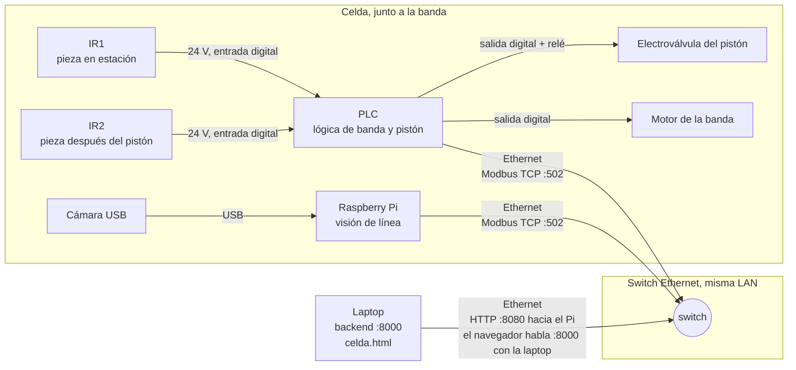
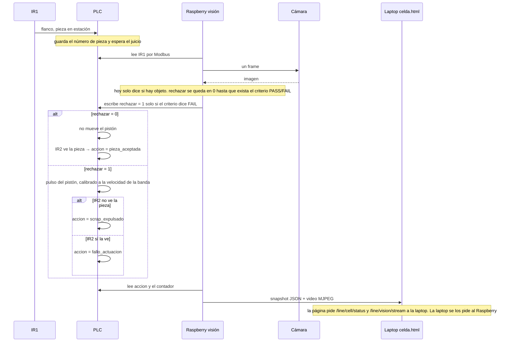

# Hoja de conexión — no entregar este archivo

La hoja para la persona está en `Conexion-de-la-celda.docx`, en esta misma carpeta. Este Markdown es la nota técnica.

# Hoja de conexión — Raspberry, visión de línea, PLC e interfaz

Para la persona que cablea la celda y la deja hablando con la pantalla que ya existe (`dashboard/celda.html`). No cambia la arquitectura del proyecto. No programa la lógica del pistón en Python.

Fecha de esta hoja: 2026-10-05.

## Lo que ya está decidido y no se reinventa aquí

- La banda, los fixtures y el pistón son la línea real. Si la visión dice `FAIL`, el pistón expulsa la pieza. Si dice `PASS`, la pieza sigue. Ver ADR 0010.
- La lógica del pistón y de la banda vive **programada en el PLC**. Este repositorio solo manda una señal simple (“rechazar”) y lee lo que el PLC hizo de verdad. Ver `contracts/line_handshake_protocol.md`.
- La pantalla no se reescribe. Ya pide dos cosas al backend de la laptop, puerto 8000:
  - video: `GET /line/vision/stream`
  - números, estado y últimas piezas: `GET /line/cell/status` (hoy sale de `backend/cell_simulator.py`, marcado `"source": "simulado"`)
- El criterio real de PASS/FAIL **todavía no existe**. El código de visión solo distingue “hay un objeto en el frame” de “no hay objeto” (`backend/main.py`, `_make_line_vision_processor`). Hasta que ese criterio exista, **no se dispara el pistón desde la detección de presencia**. Un objeto visto no es una pieza mala.

El Raspberry de esta hoja es el computador que se sienta junto a la banda: lleva la cámara de la celda y habla con el PLC. No es el Jetson del robot móvil. La cámara de inventario del robot no se enchufa aquí.

## 1. Quién hace qué

| Equipo | Dónde está | Qué hace | Qué no hace |
|---|---|---|---|
| Cámara USB | En el Raspberry, mirando la pieza en el fixture | Imagen de la estación de visión | No se conecta al PLC |
| Raspberry Pi | Junto a la banda, en la misma red que la laptop y el PLC | Corre la visión de línea. Lee al PLC si la pieza está en estación. Escribe un solo bit `rechazar` cuando el criterio diga FAIL. Publica video y el estado de la celda | No lee los infrarrojos por GPIO. No energiza el pistón. No arranca motores |
| PLC | Tablero de la celda | Dueño de la banda, del pistón y de los dos infrarrojos. Si se corta la red, apaga el pulso del pistón y puede parar la banda | No corre YOLO. No sirve la página web |
| Laptop (interfaz) | La máquina que ya corre el backend | Sigue sirviendo `http://<ip-laptop>:8000/celda.html`. Deja de usar el simulador y lee al Raspberry | No se le cablean sensores |
| Infrarrojo 1 | Antes de la cámara, sobre la banda | Avisa al PLC: “hay pieza en la estación de visión” | No va al Raspberry |
| Infrarrojo 2 | Después del pistón, todavía sobre la banda principal | Avisa al PLC: “la pieza siguió en la banda” | No va al Raspberry |

Los dos infrarrojos van al PLC. Es el sitio correcto: el PLC es quien cronometra la banda y el pistón, y ese cronómetro tiene que seguir funcionando si el Raspberry se apaga.

## 2. Diagrama de conexión



Un solo switch. Laptop, Raspberry y PLC en la misma red. El navegador de quien opera la celda abre la laptop, no un puerto nuevo del Raspberry: la página que ya existe no cambia de URL.

### Cable por cable

| De | A | Cable | Señal |
|---|---|---|---|
| IR1, hilo de salida | Entrada digital del PLC | Cable de sensor, 3 hilos | 24 V. “Pieza frente a la cámara” |
| IR2, hilo de salida | Otra entrada digital del PLC | Cable de sensor, 3 hilos | 24 V. “Pieza siguió en la banda” |
| Fuente 24 V del tablero | Café/marrón de cada IR, y común del PLC | Par de alimentación | Alimentación de sensores. El 0 V del sensor y el 0 V de las entradas del PLC son el mismo |
| Salida digital del PLC | Bobina del relé de la electroválvula | Cable de mando | El relé mete aire al pistón. El PLC no se conecta directo a una bobina de 24 V grande si la salida no da esa corriente: se usa el relé que ya traiga el tablero |
| Salida digital del PLC | Arranque de la banda, si la banda no es un motor que ya corre solo | Cable de mando | Marcha / paro |
| Cámara | USB del Raspberry | USB | Video. Índice de cámara `0` si es la única cámara de ese Pi |
| Raspberry | Switch | Ethernet | Modbus hacia el PLC y HTTP hacia la laptop |
| PLC | Switch | Ethernet | Modbus TCP, puerto 502 |
| Laptop | Switch | Ethernet | La interfaz |
| Raspberry, alimentación | Fuente oficial 5 V del Pi | USB-C / el conector que traiga el modelo | 5 V. No sale de los 24 V del PLC |

No hay ningún hilo entre el PLC y los pines GPIO del Raspberry. Una entrada de PLC a 24 V quema un GPIO de 3,3 V.

## 3. Los dos infrarrojos

Función, no modelo. El modelo exacto (PNP o NPN, distancia, 10–30 V) se lee en la etiqueta del sensor que se compró y se anota al final de esta hoja antes de energizar.

**IR1 — estación de visión.** Se monta de modo que conmute cuando la pieza queda quieta en el fixture, dentro del cuadro de la cámara, y suelte cuando la pieza ya se fue. Un flanco de subida de IR1 es el permiso para tomar **un** frame. No se inspecciona en continuo mientras la banda trae la siguiente pieza.

**IR2 — después del pistón, en la banda que sigue.** No es un sensor de “chatarra”. Confirma el efecto físico:

| Visión escribió `rechazar` | IR2 vio la pieza en su ventana de tiempo | Lo que el PLC debe reportar |
|---|---|---|
| No | Sí | `pieza_aceptada` |
| Sí | No | `scrap_expulsado` |
| Sí | Sí | `fallo_actuacion` (se pidió expulsar y la pieza siguió) |
| No | No | No inventar un PASS. Parar y alarmar: la pieza se perdió sin orden de expulsión |

Esas tres palabras (`pieza_aceptada`, `scrap_expulsado`, `fallo_actuacion`) son las únicas que la pantalla ya entiende. No agregar una cuarta.

### Cómo se cablea un infrarrojo industrial de 3 hilos

La mayoría de los PLC pequeños traen entradas a 24 V. El sensor tiene que ser de 24 V (típico 10–30 V). Un módulo infrarrojo de 5 V de Arduino **no** se conecta a esa entrada.

1. Mirar la etiqueta: **PNP** (la salida entrega +24 V al detectar) o **NPN** (la salida va a 0 V al detectar).
2. El PLC tiene que ser del mismo tipo. PNP con entrada en sumidero (común de entradas a 0 V) es lo habitual. Si no coinciden, el LED del PLC nunca prende aunque el sensor sí detecte. No se “arregla” en software.
3. Colores habituales, confirmar con la hoja del fabricante del sensor:
   - marrón = +24 V
   - azul = 0 V
   - negro = salida, al borne de la entrada del PLC (por ejemplo I0.0 para IR1, I0.1 para IR2)
4. Energizar solo el sensor, pasar la mano, y ver el LED del sensor y el LED de la entrada del PLC. Eso se prueba **antes** de conectar el Raspberry.

## 4. Qué tiene que hacer el programa, en orden

Esto es una pieza. El PLC lleva el reloj. El Raspberry lleva el ojo.



Reglas que no se negocian en código:

- Si el Raspberry no recibe latido del PLC en menos de un segundo, la pantalla pasa a `SIN_CONEXION`, `sources.plc = false`, y el Raspberry **no** deja `rechazar` en 1.
- Si el PLC deja de ver el latido del Raspberry, pone `rechazar` en 0 por su cuenta y no dispara el pistón. El paro de la banda ante pérdida de comunicación es del PLC, no de un `except` en Python. Si se va la red a media expulsión, el PLC corta el pulso: el pistón no se queda afuera.
- El botón Arrancar / Parar de `celda.html` (`POST /line/cell/run` con `{"on": true|false}`) escribe la bobina de marcha de la banda. Parar pone el estado `DETENIDA` y el motivo `Paro solicitado por el operador`, que es el texto que la página ya muestra.
- El tiempo del pulso del pistón no se copia de esta hoja. Se mide con la banda real. Punto de partida para la primera prueba en vacío: 150 a 300 ms, y se ajusta hasta que la pieza salga sin quedarse a medias.

### Mapa de señales

Las direcciones de la columna “ejemplo” son para poder escribir el programa de prueba. **No son las del PLC comprado.** Quien programe el PLC las anota en la columna “real” y esas son las que quedan en el código. Hasta llenar esa columna no se declara el enlace como terminado.

| Nombre en código | Dirección | Quién escribe | Ejemplo Modbus | Real |
|---|---|---|---|---|
| `ir1_en_estacion` | Entrada discreta | PLC, desde IR1 | 0 | |
| `ir2_en_banda` | Entrada discreta | PLC, desde IR2 | 1 | |
| `rechazar` | Bobina | Raspberry. 1 solo en FAIL | 10 | |
| `banda_marcha` | Bobina | Raspberry, copiando el botón de la pantalla | 11 | |
| `rpi_vivo` | Bobina | Raspberry, se reescribe al menos 2 veces por segundo | 12 | |
| `plc_vivo` | Registro de entrada | PLC, contador que sube solo | 0 | |
| `accion` | Registro de retención | PLC. 0 nada nuevo, 1 aceptada, 2 scrap, 3 fallo de actuación | 20 | |
| `pieza_id` | Registro de retención | PLC, sube en cada flanco de IR1 | 21 | |

`accion` y `pieza_id` los lee el Raspberry una vez por pieza nueva. No se vuelven a contar si el mismo `pieza_id` sigue ahí.

## 5. Red de prueba

Sugerencia para el banco. Si el laboratorio ya tiene otras IP, se usan esas y se apuntan aquí.

| Equipo | IP | Puerto |
|---|---|---|
| Laptop (interfaz) | 192.168.0.10 | 8000, ya usado por `uvicorn` |
| Raspberry | 192.168.0.20 | 8080, agente de celda |
| PLC | 192.168.0.30 | 502, Modbus TCP |

Comprobar, desde la laptop, antes de escribir código de visión:

```powershell
ping 192.168.0.20
ping 192.168.0.30
```

Modbus va por cable. Wi‑Fi solo para mirar la página, si hace falta. Una caída de Wi‑Fi se ve en la pantalla como `SIN_CONEXION` y no debe mover el pistón.

## 6. Cómo se enchufa a la interfaz que ya existe

La página (`dashboard/celda.js`) pide `GET /line/cell/status` cada segundo y pinta `state`, `counts`, `sources.plc` y `recent`. El video lo pide `dashboard/line-vision.js` a `GET /line/vision/stream`. Esas dos rutas se quedan. El Raspberry no abre otra página.

Hoy `GET /line/cell/status` llama a `cell_simulator.snapshot(...)` y el video abre la cámara de la laptop (`LINE_VISION_CAMERA_INDEX`). El trabajo de software es cambiar **solo la fuente** de esas dos rutas cuando exista la variable `CELL_AGENT_URL`. Sin esa variable, todo sigue simulado como ahora: la laptop no depende del Raspberry para el resto del sistema (inventario, robot).

La marca `SIM` de `dashboard/celda.html` está escrita fija en el HTML (tres `<span class="hmi-tag">SIM</span>`). No se apaga sola cuando lleguen datos reales. Se quita en el mismo cambio en que `source` deje de ser `"simulado"`.

Forma del JSON que la página ya consume. El Raspberry lo entrega en `GET http://192.168.0.20:8080/cell/snapshot`. La laptop lo reenvía tal cual en `/line/cell/status`.

```json
{
  "source": "celda",
  "running": true,
  "state": "OPERANDO",
  "reason": null,
  "sources": { "vision_linea": true, "plc": true },
  "counts": { "inspected": 12, "pass": 10, "fail": 2 },
  "recent": [
    {
      "pieza": 12,
      "resultado": "PASS",
      "accion": "pieza_aceptada",
      "timestamp": "2026-10-05T18:00:00+00:00"
    }
  ],
  "updated_at": "2026-10-05T18:00:01+00:00"
}
```

`state` solo puede ser `OPERANDO`, `DETENIDA` o `SIN_CONEXION`. `resultado` solo `PASS` o `FAIL`. `accion` solo las tres de la tabla de IR2. `recent` va de la pieza más nueva a la más vieja, máximo 8, igual que el simulador.

Mientras no exista el criterio de inspección, `recent` no se llena con PASS/FAIL inventados a partir de “vi un objeto”. El video sí se publica, con el letrero que el código ya dibuja (`PIEZA DETECTADA` / `SIN PIEZA`). Los contadores se quedan en 0 y `rechazar` en 0. La prueba del pistón, en ese periodo, es un botón físico del PLC marcado como prueba de cableado, no un resultado de visión.

## 7. Código de ejemplo

Corre en el Raspberry. Ahí sí se instala `pymodbus` (y OpenCV, que el proyecto ya usa) cuando el mapa de la sección 4 esté lleno. La laptop no lo necesita: solo hace HTTP. El ejemplo usa el servidor HTTP de la biblioteca estándar para no meter otro framework.

Las direcciones de abajo son las de la columna “ejemplo”. Se cambian por las de la columna “real”.

El PLC, al incrementar `pieza_id`, pone `accion` en 0 en ese mismo ciclo. Solo después, cuando IR2 ya resolvió, escribe 1, 2 o 3. Si no hace ese cero, el Raspberry puede atribuirle a la pieza nueva el resultado de la anterior.

```python
#!/usr/bin/env python3
"""Agente de celda. Corre en el Raspberry. La laptop solo le hace HTTP."""
import json
import threading
import time
from datetime import datetime, timezone
from http.server import BaseHTTPRequestHandler, ThreadingHTTPServer

import cv2
from pymodbus.client import ModbusTcpClient

PLC_HOST = "192.168.0.30"
# Direcciones de ejemplo. Sustituir por la columna "real" de esta hoja.
IR1 = 0
COIL_RECHAZAR, COIL_BANDA, COIL_VIVO = 10, 11, 12
REG_VIVO, REG_ACCION, REG_PIEZA = 0, 20, 21
ACCION = {1: "pieza_aceptada", 2: "scrap_expulsado", 3: "fallo_actuacion"}

lock = threading.Lock()
estado = {
    "source": "celda",
    "running": False,
    "state": "SIN_CONEXION",
    "reason": "Arrancando",
    "sources": {"vision_linea": False, "plc": False},
    "counts": {"inspected": 0, "pass": 0, "fail": 0},
    "recent": [],
    "updated_at": None,
}
ultimo_jpeg = None


def ahora():
    return datetime.now(timezone.utc).isoformat()


def lazo():
    global ultimo_jpeg
    plc = ModbusTcpClient(PLC_HOST, port=502, timeout=0.4)
    cam = cv2.VideoCapture(0)
    latido_anterior = None
    latido_cambio = None
    ultima_pieza = None
    pieza_en_cero = set()

    while True:
        if not plc.connect():
            with lock:
                estado["sources"] = {"vision_linea": cam.isOpened(), "plc": False}
                estado["state"] = "SIN_CONEXION"
                estado["reason"] = "El PLC no responde"
                estado["updated_at"] = ahora()
            time.sleep(0.5)
            continue

        plc.write_coil(COIL_VIVO, True)
        latido = plc.read_input_registers(REG_VIVO, count=1)
        if latido.isError():
            time.sleep(0.2)
            continue
        valor = latido.registers[0]
        if valor != latido_anterior:
            latido_anterior = valor
            latido_cambio = time.monotonic()
        elif latido_cambio and time.monotonic() - latido_cambio > 1:
            plc.write_coil(COIL_RECHAZAR, False)
            with lock:
                estado["sources"] = {"vision_linea": cam.isOpened(), "plc": False}
                estado["state"] = "SIN_CONEXION"
                estado["reason"] = "El PLC no late"
                estado["updated_at"] = ahora()
            time.sleep(0.2)
            continue

        ir1 = plc.read_discrete_inputs(IR1, count=1)
        pieza = plc.read_holding_registers(REG_PIEZA, count=1)
        accion_reg = plc.read_holding_registers(REG_ACCION, count=1)
        if ir1.isError() or pieza.isError() or accion_reg.isError():
            time.sleep(0.2)
            continue

        # El criterio PASS/FAIL no existe todavía: no se pide expulsar.
        # Cuando exista, esta línea pasa a True solo si ESA pieza es FAIL.
        plc.write_coil(COIL_RECHAZAR, False)

        pid = pieza.registers[0]
        if ir1.bits[0] and cam.isOpened():
            ok_frame, frame = cam.read()
            if ok_frame:
                cv2.putText(
                    frame, "PIEZA DETECTADA", (24, 48),
                    cv2.FONT_HERSHEY_SIMPLEX, 1.1, (0, 200, 0), 3,
                )
                ultimo_jpeg = cv2.imencode(".jpg", frame)[1].tobytes()

        codigo = accion_reg.registers[0]
        if codigo == 0:
            pieza_en_cero.add(pid)
        elif pid in pieza_en_cero and pid != ultima_pieza and codigo in ACCION:
            accion = ACCION[codigo]
            resultado = "PASS" if accion == "pieza_aceptada" else "FAIL"
            with lock:
                estado["counts"]["inspected"] += 1
                estado["counts"]["fail" if resultado == "FAIL" else "pass"] += 1
                estado["recent"].insert(0, {
                    "pieza": pid,
                    "resultado": resultado,
                    "accion": accion,
                    "timestamp": ahora(),
                })
                del estado["recent"][8:]
            ultima_pieza = pid
            pieza_en_cero.discard(pid)

        with lock:
            estado["sources"] = {"vision_linea": cam.isOpened(), "plc": True}
            if estado["running"]:
                estado["state"] = "OPERANDO"
                estado["reason"] = None
            else:
                estado["state"] = "DETENIDA"
                estado["reason"] = "Paro solicitado por el operador"
            estado["updated_at"] = ahora()
        time.sleep(0.2)


class Handler(BaseHTTPRequestHandler):
    def log_message(self, fmt, *args):
        return

    def _json(self, code, body):
        raw = json.dumps(body).encode()
        self.send_response(code)
        self.send_header("Content-Type", "application/json")
        self.send_header("Content-Length", str(len(raw)))
        self.end_headers()
        self.wfile.write(raw)

    def do_GET(self):
        if self.path.startswith("/cell/snapshot"):
            with lock:
                self._json(200, dict(estado))
            return
        if self.path.startswith("/vision/stream"):
            self.send_response(200)
            self.send_header("Content-Type", "multipart/x-mixed-replace; boundary=frame")
            self.end_headers()
            borde = b"--frame\r\nContent-Type: image/jpeg\r\n\r\n"
            while True:
                jpg = ultimo_jpeg
                if jpg is None:
                    time.sleep(0.05)
                    continue
                try:
                    self.wfile.write(borde + jpg + b"\r\n")
                    self.wfile.flush()
                except (BrokenPipeError, ConnectionResetError):
                    break
                time.sleep(0.05)
            return
        self._json(404, {"error": "no"})

    def do_POST(self):
        if not self.path.startswith("/cell/run"):
            self._json(404, {"error": "no"})
            return
        n = int(self.headers.get("Content-Length", "0"))
        on = bool(json.loads(self.rfile.read(n) or b"{}").get("on"))
        plc = ModbusTcpClient(PLC_HOST, port=502, timeout=0.4)
        if not plc.connect():
            self._json(503, {"error": "plc"})
            return
        plc.write_coil(COIL_BANDA, on)
        plc.close()
        with lock:
            estado["running"] = on
            self._json(200, dict(estado))


if __name__ == "__main__":
    threading.Thread(target=lazo, daemon=True).start()
    ThreadingHTTPServer(("0.0.0.0", 8080), Handler).serve_forever()
```

Ese archivo es el encargo del Raspberry. `plc.write_coil(COIL_RECHAZAR, False)` se queda así hasta que exista el criterio de inspección: se reemplaza por el juicio de esa pieza, no por “hay un objeto en la imagen”.

En la laptop, el cambio es la fuente de las dos rutas que la página ya usa. Sin `CELL_AGENT_URL` en el entorno, se deja el simulador y la cámara local exactamente como están.

```python
# backend/main.py — solo la idea del puente. No sustituye el simulador
# si la variable no está definida.
import json
import os
import urllib.request

CELL_AGENT_URL = os.environ.get("CELL_AGENT_URL")  # http://192.168.0.20:8080


def _celda_real(path: str, timeout: float):
    with urllib.request.urlopen(CELL_AGENT_URL + path, timeout=timeout) as resp:
        return resp


# Dentro de line_cell_status(), antes del simulador:
if CELL_AGENT_URL:
    try:
        return json.load(_celda_real("/cell/snapshot", 0.8))
    except Exception:
        return {
            "source": "celda",
            "running": False,
            "state": "SIN_CONEXION",
            "reason": "El Raspberry de la celda no responde",
            "sources": {"vision_linea": False, "plc": False},
            "counts": {"inspected": 0, "pass": 0, "fail": 0},
            "recent": [],
            "updated_at": datetime.now(UTC).isoformat(),
        }

# Dentro de line_vision_stream(), si CELL_AGENT_URL está definida,
# no abrir la cámara de la laptop: reenviar los bytes del Raspberry.
# El tipo de respuesta sigue siendo
# multipart/x-mixed-replace; boundary=frame
# porque line-vision.js ya apunta un  a /line/vision/stream.

# Dentro de line_cell_run(), el mismo puente, para que el botón
# Arrancar/Parar de celda.html llegue a la bobina de la banda:
if CELL_AGENT_URL:
    req = urllib.request.Request(
        CELL_AGENT_URL + "/cell/run",
        data=json.dumps({"on": body.on}).encode(),
        headers={"Content-Type": "application/json"},
        method="POST",
    )
    return json.load(urllib.request.urlopen(req, timeout=0.8))
```

Arranque de la interfaz, igual que hoy (`URLS_Y_COMANDOS.md`), con la variable puesta en la misma terminal:

```powershell
cd backend
$env:CELL_AGENT_URL = "http://192.168.0.20:8080"
.\.venv\Scripts\python.exe -m uvicorn main:app --host 0.0.0.0 --port 8000
```

La página se abre en `http://<ip-de-la-laptop>:8000/celda.html`. El botón “Iniciar cámara” sigue llamando a `/line/vision/stream`.

## 8. Orden de trabajo

1. Anotar marca y modelo del PLC, de cada infrarrojo (PNP o NPN) y de la cámara. Llenar la columna “real” del mapa.
2. Cablear IR1 e IR2 solo al PLC. Probar el LED de cada entrada con la mano, sin Raspberry.
3. Programar en el PLC el mapa, el latido, el pulso del pistón y la tabla de IR2. Probar el pistón con el botón de prueba del propio PLC, en vacío, sin visión.
4. Poner IP fijas y comprobar `ping` desde la laptop al Pi y al PLC.
5. Enchufar la cámara al USB del Raspberry. Correr el agente y abrir `http://192.168.0.20:8080/vision/stream` en el navegador de la laptop. Tiene que verse el video antes de tocar el backend.
6. Abrir `http://192.168.0.20:8080/cell/snapshot`. `sources.plc` tiene que pasar a `true` cuando el PLC conteste.
7. Exportar `CELL_AGENT_URL` y levantar el backend. Abrir `celda.html`. El video de “Iniciar cámara” es el del Raspberry. El recuadro “Enlace PLC” pasa a OK.
8. Una pieza de prueba con `rechazar` forzado en 0: IR1 cuenta, IR2 confirma, la pantalla muestra `pieza_aceptada` solo cuando el PLC lo diga.
9. Una pieza con el botón de prueba del PLC (no con la visión): la pantalla muestra `scrap_expulsado` o, si la pieza no sale, `fallo_actuacion`.
10. Desconectar el cable Ethernet del PLC: en menos de dos segundos la pantalla dice `SIN_CONEXION` y el pistón no se queda accionado.

## 9. Qué no hacer

- No cablear los infrarrojos a los GPIO del Raspberry “para ir más rápido”.
- No meter 24 V al Raspberry.
- No tratar `PIEZA DETECTADA` como `FAIL`.
- No inventar tópicos MQTT para esta pantalla. La pantalla habla REST. MQTT queda para la bitácora de observaciones cuando ese listener exista.
- No escribir un cliente Modbus dentro de `edge/manipulation/line_actuation/plc_backend/` hasta que la columna “real” de esta hoja esté llena. Esa carpeta está vacía a propósito.
- No cambiar `celda.js` para leer otra URL. Si la página pide algo distinto de `/line/cell/status` y `/line/vision/stream`, el enlace está mal hecho.

## 10. Datos que faltan y hay que escribir a mano

| Dato | Valor |
|---|---|
| Marca y modelo del PLC | |
| IR1: marca, PNP o NPN, borne del PLC | |
| IR2: marca, PNP o NPN, borne del PLC | |
| Salida del pistón (borne y si lleva relé) | |
| ¿La banda ya corre sola, o el PLC la arranca? | |
| IP real de laptop / Raspberry / PLC | |
| Duración del pulso del pistón, medida en la banda | |
