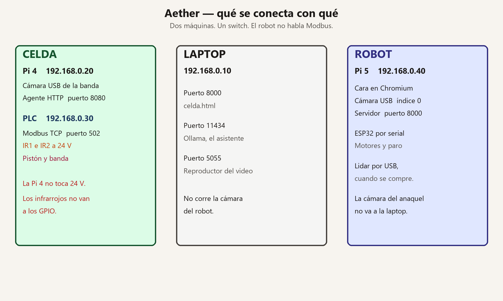
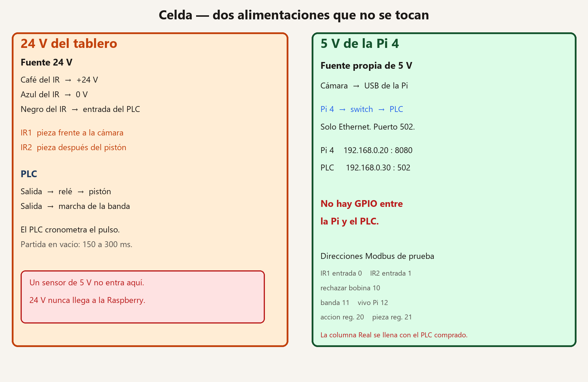
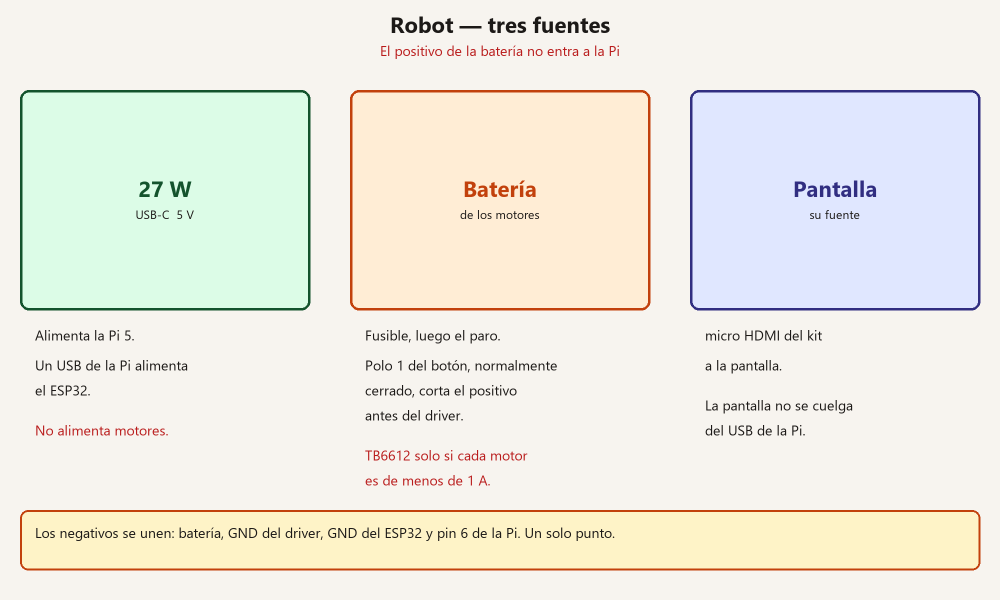
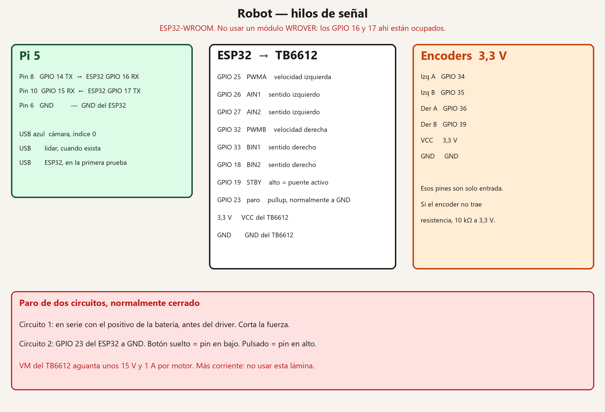
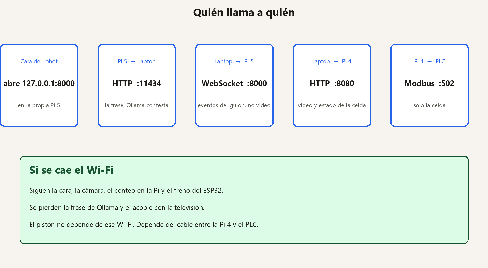
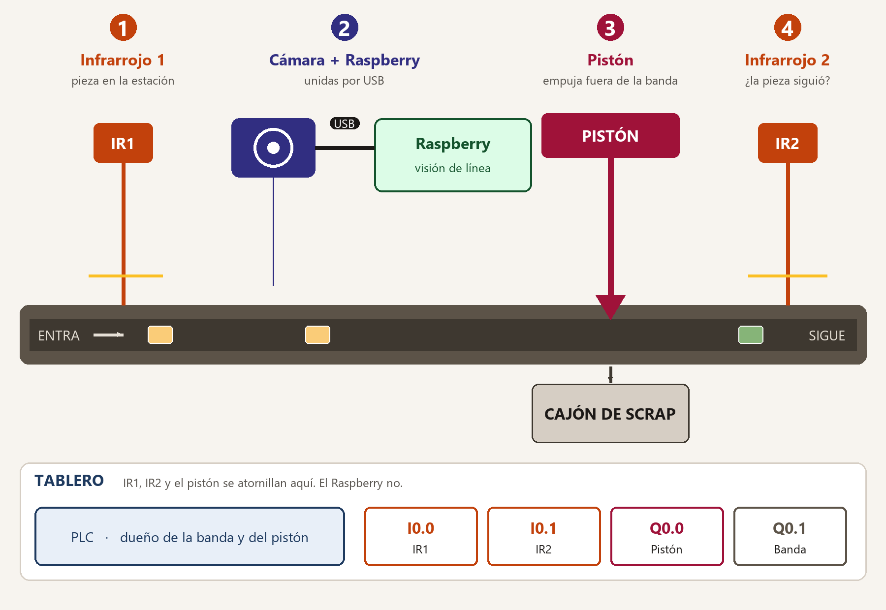
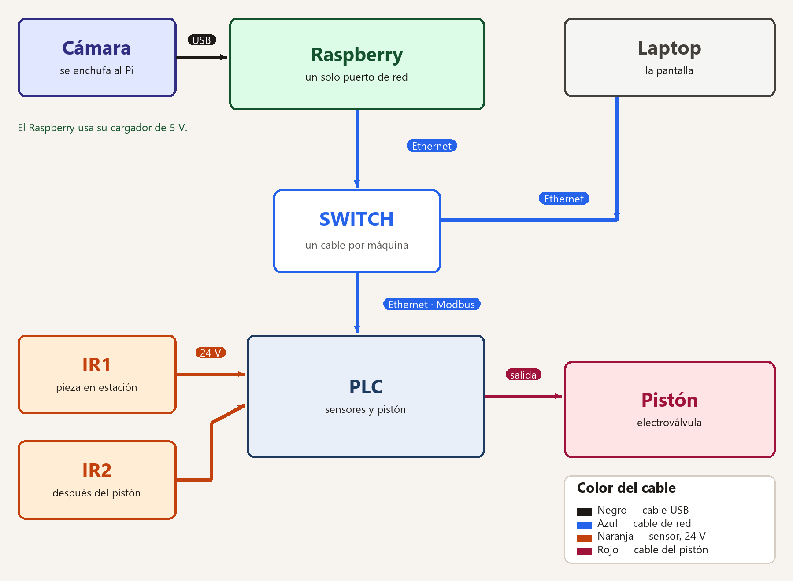
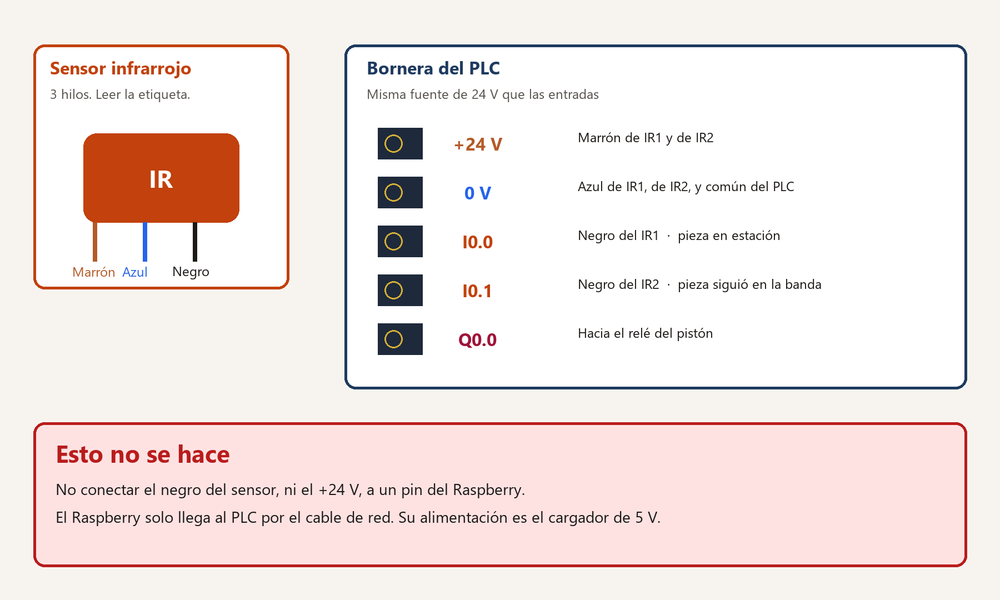
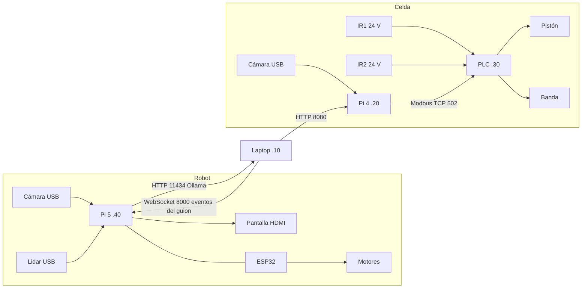
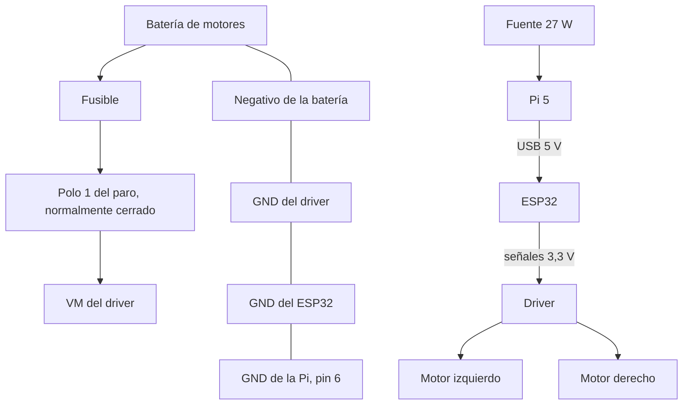

# Aether — Guía de construcción

Para cablear y encender el proyecto sin inventar otra arquitectura.
Fecha: 2026-10-09.

Hay dos máquinas distintas. No comparten cámara, no comparten placa y no
comparten el Modbus.

| Máquina | Placa | Dónde está | Qué hace |
|---|---|---|---|
| Celda de manufactura | Raspberry Pi 4 | Junto a la banda | Cámara de la pieza, Modbus con el PLC |
| Robot | Raspberry Pi 5 de 8 GB | Encima del robot | Cara, cámara del anaquel, voz, serial al ESP32 |
| Laptop | La que ya corre el proyecto | En la red | Celda en pantalla, Ollama, reproductor del video |
| PLC | El del tablero | Tablero de la celda | Banda, pistón, dos infrarrojos. No habla con el robot |

La compra del robot es el kit Raspberry Pi 5 de 8 GB con fuente oficial de
27 W, disipador activo, microSD y cable micro HDMI. La cara y el asistente
no necesitan Jetson: la laptop piensa, el robot mira parado en un punto.

## Láminas

Están en `docs/hardware/figuras/`. Se abren con el visor de fotos. No hace
falta Proteus ni FluidSIM.











La banda, el sensor de tres hilos y la bornera ya estaban dibujados para
imprimir:







En la lámina de bornes, I0.0, I0.1 y Q0.0 son el ejemplo. El borne real es
el de la etiqueta del PLC que esté en el tablero.

## 1. Red

Un switch. Cable de red a la laptop, a la Pi 4, a la Pi 5 y al PLC.
El Wi-Fi no mueve el pistón ni los motores.

| Equipo | IP fija | Puerto | Quién le habla |
|---|---|---|---|
| Laptop | 192.168.0.10 | 8000 | El navegador de la celda (`celda.html`) |
| Laptop | 192.168.0.10 | 11434 | La Pi 5, para Ollama |
| Laptop | 192.168.0.10 | 5055 | El reproductor del video, en la propia laptop |
| Pi 4, celda | 192.168.0.20 | 8080 | La laptop, para video y estado de la celda |
| PLC | 192.168.0.30 | 502 | Solo la Pi 4, Modbus TCP |
| Pi 5, robot | 192.168.0.40 | 8000 | La cara, el reproductor y quien mire el inventario |

Comprobar desde la laptop:

```powershell
ping 192.168.0.20
ping 192.168.0.30
ping 192.168.0.40
```

En Windows, la primera vez que algo de afuera entre a Python o a Ollama,
el firewall pregunta. Hay que permitir red privada.



## 2. Celda: qué cablear

La hoja completa, con el programa Python del agente, ya está en
`docs/hardware/datasheet-conexion-celda.md`. Esta sección es el cableado
físico. No se repite el programa aquí para no tener dos copias.

### Alimentación

La fuente de 24 V del tablero alimenta el PLC, los infrarrojos y la bobina
del relé del pistón. La Pi 4 se alimenta con su fuente de 5 V, aparte.
No hay hilo de 24 V hacia la Pi. Un GPIO de la Pi es de 3,3 V: 24 V lo quema.

No hay hilo entre el PLC y los GPIO de la Pi. Hablan por Ethernet.

### Sensores

Cada infrarrojo es de 24 V, salida PNP, tres hilos. Un módulo de 5 V de
Arduino no sirve en esta entrada.

| Hilo del sensor | A dónde |
|---|---|
| Café o marrón | +24 V del tablero |
| Azul | 0 V del tablero, el mismo 0 V de las entradas del PLC |
| Negro | Borne de entrada del PLC |

IR1 mira la pieza frente a la cámara. IR2 mira la pieza después del pistón,
todavía sobre la banda. Los dos entran al PLC, nunca a la Pi.

Antes de conectar la Pi: energizar solo el sensor, pasar la mano, y ver el
LED del sensor y el LED de la entrada del PLC. Si el sensor es NPN y la
entrada espera PNP, el LED del PLC no prende. Eso no se arregla en Python.

### Actuadores

| De | A | Qué es |
|---|---|---|
| Salida digital del PLC | Bobina del relé de la electroválvula | El relé mete el aire al pistón. El PLC no alimenta la bobina grande si su salida no da esa corriente |
| Salida digital del PLC | Marcha de la banda | Solo si la banda no corre ya por su cuenta |
| Cámara USB | USB de la Pi 4 | Índice 0 si es la única cámara de esa Pi |
| Pi 4 | Switch | Ethernet |
| PLC | Switch | Ethernet, puerto 502 |

El pulso del pistón lo cronometra el PLC, no la Pi. Primera prueba en vacío,
sin pieza: 150 a 300 ms, y se ajusta en la banda real. Si se corta la red
a media expulsión, el PLC suelta el pulso. El pistón no se queda afuera.

### Modbus

Estas direcciones son las de prueba de la hoja de la celda. No son las de
tu PLC hasta que alguien lea el manual del modelo que está en el tablero y
llene la columna Real. El archivo
`edge/manipulation/line_actuation/plc_backend/` está vacío a propósito hasta
ese momento.

| Nombre | Quién escribe | Ejemplo | Real, llenar a mano |
|---|---|---|---|
| `ir1_en_estacion` | PLC, desde IR1 | entrada discreta 0 | |
| `ir2_en_banda` | PLC, desde IR2 | entrada discreta 1 | |
| `rechazar` | Pi 4. 1 solo si la pieza es FAIL | bobina 10 | |
| `banda_marcha` | Pi 4, el botón Arrancar/Parar | bobina 11 | |
| `rpi_vivo` | Pi 4, al menos 2 veces por segundo | bobina 12 | |
| `plc_vivo` | PLC, un contador que sube solo | registro de entrada 0 | |
| `accion` | PLC. 0 nada, 1 aceptada, 2 scrap, 3 fallo | registro 20 | |
| `pieza_id` | PLC, sube en cada flanco de IR1 | registro 21 | |

`accion`: 1 es `pieza_aceptada`, 2 es `scrap_expulsado`, 3 es
`fallo_actuacion`. Si la visión dijo FAIL y el pistón no se confirmó, el
PLC escribe 3, no 1.

Latidos: si la Pi deja de ver subir `plc_vivo` durante 1 segundo, no deja
`rechazar` en 1. Si el PLC deja de ver `rpi_vivo`, pone `rechazar` en 0 y
no dispara.

Hoy la visión solo distingue “hay objeto” de “no hay objeto”. Eso no es
FAIL. `rechazar` se queda en 0 hasta que exista el criterio de inspección.
El video sí se publica, con el letrero `PIEZA DETECTADA` o `SIN PIEZA`.

### Programa de la celda

1. Copiar el agente de la sección 7 de `docs/hardware/datasheet-conexion-celda.md` a la Pi 4 y correrlo. Escucha en el puerto 8080.
2. En la laptop, en la misma terminal del backend:

```powershell
cd backend
$env:CELL_AGENT_URL = "http://192.168.0.20:8080"
.\.venv\Scripts\python.exe -m uvicorn main:app --host 0.0.0.0 --port 8000
```

3. Abrir `http://192.168.0.10:8000/celda.html`.

Sin `CELL_AGENT_URL`, la página sigue en simulador. No hay que cambiar
`celda.js`. La página ya pide `/line/cell/status` y `/line/vision/stream`.

Orden de prueba, sin saltos:

1. Anotar marca del PLC, de cada infrarrojo y de la cámara. Llenar la columna Real.
2. Cablear IR1 e IR2 solo al PLC. Probar los LED con la mano.
3. Programar en el PLC el mapa, el latido y el pulso. Probar el pistón con el botón de prueba del PLC, en vacío.
4. `ping` a .20 y a .30.
5. Cámara en la Pi 4. Abrir `http://192.168.0.20:8080/vision/stream`. Tiene que verse el video.
6. Abrir `http://192.168.0.20:8080/cell/snapshot`. `sources.plc` en `true` cuando el PLC conteste.
7. Levantar el backend con `CELL_AGENT_URL`. En `celda.html`, el video es el de la Pi 4.
8. Una pieza con `rechazar` en 0: la pantalla muestra `pieza_aceptada` solo cuando el PLC lo escriba.
9. Desconectar el Ethernet del PLC: en menos de dos segundos la pantalla dice `SIN_CONEXION` y el pistón no sigue accionado.

## 3. Robot: alimentación

Tres fuentes. No se mezclan.

| Fuente | Alimenta | No alimenta |
|---|---|---|
| Fuente oficial 27 W, USB-C, 5 V | Pi 5, y por un cable USB el ESP32 | Motores |
| Batería de los motores, con fusible | El driver de motores, y de ahí los motores | La Pi, el ESP32, el lidar |
| Fuente de la pantalla | La pantalla HDMI | — |

El disipador activo va sobre el procesador. No se monta además el ventilador
de la tapa. Los 0 V de la batería de motores y el GND de la Pi se unen en
un solo punto, en el GND del driver. El positivo de la batería no entra a
la Pi.

Paro de emergencia: un botón de dos circuitos, normalmente cerrado.

- Un circuito va en serie con el positivo de la batería, antes del driver. Al pulsarlo se corta la fuerza de los motores aunque el programa esté colgado.
- El otro circuito va del GPIO 23 del ESP32 a GND. Con el botón suelto, el pin lee bajo. Al pulsar, el circuito abre y el pullup interno lee alto: el programa frena.



## 4. Robot: cables de datos

| De | A | Cable |
|---|---|---|
| Cámara USB | Puerto USB 3 azul de la Pi 5 | USB. Es la única cámara de esta Pi. El programa la abre como índice 0 |
| Lidar 2D, cuando se compre | Otro USB de la Pi 5 | USB. No va al ESP32. No existe todavía el programa de ruta |
| Pantalla | micro HDMI de la Pi, con el cable del kit | HDMI. La pantalla con su propia fuente |
| Micrófono y bocina | USB o el jack de la pantalla | Los usa Chromium en la Pi |
| ESP32 | Pi 5 | USB, para la primera prueba. Después, tres hilos de serial |

Serial definitivo, las dos placas son de 3,3 V. Se cruzan TX y RX. GND común.

| Pi 5, pin físico | Pi 5, señal | ESP32 DevKit |
|---|---|---|
| 8 | GPIO 14, TX | GPIO 16, RX2 |
| 10 | GPIO 15, RX | GPIO 17, TX2 |
| 6 | GND | GND |

En la Pi 5, en `/boot/firmware/config.txt`:

```
dtparam=uart0=on
```

Reiniciar. El dispositivo tiene que aparecer como `/dev/ttyAMA0`. Si no
aparece, no se adivina otro nombre: `ls /dev/ttyAMA*` y se usa el que salga.
Mientras tanto vale el cable USB, que aparece como `/dev/ttyUSB0` o
`/dev/ttyACM0`.

## 5. Robot: driver de banco

Este cableado es para un TB6612FNG y dos motores de menos de 1 A continuos
cada uno. VM del TB6612 aguanta hasta unos 15 V. Si la etiqueta del motor
dice más de 1 A, o el robot es de tamaño persona, este driver no se usa.
Se anota el voltaje y la corriente de la etiqueta y se cambia el driver.
Los pines del ESP32 de esta tabla ya no sirven para otro modelo.

VCC del TB6612 sale del 3,3 V del ESP32, no de la batería. GND del TB6612
al GND del ESP32.

| TB6612 | ESP32 | Función |
|---|---|---|
| PWMA | GPIO 25 | Velocidad izquierda |
| AIN1 | GPIO 26 | Sentido izquierdo |
| AIN2 | GPIO 27 | Sentido izquierdo |
| PWMB | GPIO 32 | Velocidad derecha |
| BIN1 | GPIO 33 | Sentido derecho |
| BIN2 | GPIO 18 | Sentido derecho |
| STBY | GPIO 19 | Alto = puente activo |
| AO1, AO2 | Motor izquierdo | |
| BO1, BO2 | Motor derecho | |
| VM | Polo 1 del paro | Batería, ya fusionada |
| VCC | 3,3 V del ESP32 | |
| GND | GND | |

Encoders de efecto Hall, alimentados a 3,3 V desde el ESP32. No a 5 V.

| Encoder | ESP32 |
|---|---|
| Izquierdo A | GPIO 34 |
| Izquierdo B | GPIO 35 |
| Derecho A | GPIO 36 |
| Derecho B | GPIO 39 |
| VCC de cada encoder | 3,3 V |
| GND de cada encoder | GND |

Esos cuatro GPIO del ESP32 son solo entrada. No llevan pullup interno útil.
Si el encoder no trae su propia resistencia, hay que poner 10 kΩ de la señal
a 3,3 V.

## 6. Robot: programa del ESP32

Pegar en el Arduino IDE, placa “ESP32 Dev Module”, y subir por USB.
Velocidad del monitor: 115200.

El ESP32 frena solo si pasan más de 300 ms sin una línea `H` desde la Pi.
El paro físico corta la batería igual, aunque este programa esté congelado.

Líneas que entiende, una por renglón:

| Línea | Efecto |
|---|---|
| `H` | Latido. Sin esto, a los 300 ms los motores quedan en freno |
| `M <izq> <der>` | Velocidad de −100 a 100. Ejemplo: `M 40 -40` |
| `S` | Freno ya |

Responde `estop` si el botón está pulsado, o `ok` en caso contrario.

```cpp
#include <Arduino.h>

static const int PWMA = 25, AIN1 = 26, AIN2 = 27;
static const int PWMB = 32, BIN1 = 33, BIN2 = 18, STBY = 19;
static const int ESTOP = 23;
static const int ENC_LA = 34, ENC_LB = 35, ENC_RA = 36, ENC_RB = 39;

static volatile long ticksL = 0, ticksR = 0;
static char linea[32];
static uint8_t n = 0;
static uint32_t ultimoH = 0;
static bool habilitado = false;

static void IRAM_ATTR isrL() { ticksL += (digitalRead(ENC_LB) ? 1 : -1); }
static void IRAM_ATTR isrR() { ticksR += (digitalRead(ENC_RB) ? 1 : -1); }

static void puente(int pwm, int in1, int in2, int vel) {
  vel = constrain(vel, -100, 100);
  bool adelante = vel >= 0;
  digitalWrite(in1, adelante);
  digitalWrite(in2, !adelante);
  ledcWrite(pwm, map(abs(vel), 0, 100, 0, 255));
}

static void frenar() {
  digitalWrite(STBY, LOW);
  puente(PWMA, AIN1, AIN2, 0);
  puente(PWMB, BIN1, BIN2, 0);
  habilitado = false;
}

static void aplicar(int izq, int der) {
  if (digitalRead(ESTOP)) {
    frenar();
    return;
  }
  digitalWrite(STBY, HIGH);
  puente(PWMA, AIN1, AIN2, izq);
  puente(PWMB, BIN1, BIN2, der);
  habilitado = true;
}

void setup() {
  Serial.begin(115200);
  pinMode(AIN1, OUTPUT); pinMode(AIN2, OUTPUT);
  pinMode(BIN1, OUTPUT); pinMode(BIN2, OUTPUT);
  pinMode(STBY, OUTPUT);
  pinMode(ESTOP, INPUT_PULLUP);
  ledcAttach(PWMA, 20000, 8);
  ledcAttach(PWMB, 20000, 8);
  pinMode(ENC_LA, INPUT); pinMode(ENC_LB, INPUT);
  pinMode(ENC_RA, INPUT); pinMode(ENC_RB, INPUT);
  attachInterrupt(ENC_LA, isrL, RISING);
  attachInterrupt(ENC_RA, isrR, RISING);
  frenar();
  ultimoH = millis();
}

void loop() {
  while (Serial.available()) {
    char c = Serial.read();
    if (c == '\n') {
      linea[n] = 0;
      n = 0;
      if (linea[0] == 'H') ultimoH = millis();
      else if (linea[0] == 'S') frenar();
      else if (linea[0] == 'M') {
        int izq = 0, der = 0;
        sscanf(linea + 1, "%d %d", &izq, &der);
        ultimoH = millis();
        aplicar(izq, der);
      }
    } else if (n < sizeof(linea) - 1 && c != '\r') {
      linea[n++] = c;
    }
  }
  if (digitalRead(ESTOP) || millis() - ultimoH > 300) frenar();
  static uint32_t impresion = 0;
  if (millis() - impresion > 200) {
    impresion = millis();
    Serial.println(digitalRead(ESTOP) ? "estop" : "ok");
  }
}
```

`ledcAttach` es del core ESP32 de Arduino 3.x. Si el IDE trae el core 2.x,
hay que actualizar el core en el gestor de placas. No se reescribe el
programa con la API vieja hasta ver el error de compilación.

Prueba desde la Pi, con el USB del ESP32 y las ruedas en el aire:

```python
import time, serial
ser = serial.Serial("/dev/ttyACM0", 115200, timeout=0.2)
time.sleep(2)
ser.write(b"M 30 30\n")
time.sleep(1)
ser.write(b"S\n")
print(ser.readline())
```

Si el puerto no es `ttyACM0`, `ls /dev/ttyACM* /dev/ttyUSB*` y se usa ese.
Las ruedas no se prueban en el suelo hasta que `S` y el botón de paro las
hayan detenido en el aire.

## 7. Robot: programa de la Pi 5

En la Pi 5, Raspberry Pi OS de 64 bits. Clonar este repositorio. En
`backend/`:

```bash
python3 -m venv .venv
.venv/bin/pip install -r requirements.txt
```

`requirements.txt` instala FastAPI, uvicorn, OpenCV, ultralytics y pyzbar.
Eso es el servidor que ya dibuja la cara y corre YOLO.

Archivo `backend/.env` en la Pi, además de las claves que ya use el equipo:

```
OLLAMA_URL=http://192.168.0.10:11434/api/chat
OLLAMA_MODEL=llama3.2:1b
```

Arranque:

```bash
cd backend
.venv/bin/python -m uvicorn main:app --host 0.0.0.0 --port 8000
```

En la pantalla del robot, Chromium a pantalla completa abre
`http://127.0.0.1:8000/robot.html`. La cámara no sale de la Pi.
`GET /perception/stream` es el video ya con las cajas. Solo se abre cuando
la cara entra en modo cámara.

YOLO en esta placa no se deja en PyTorch. En la laptop, una vez:

```bash
.venv/bin/yolo export model=yolov8n.pt format=ncnn
```

Se copia la carpeta exportada a la Pi. Medir ahí, con la cámara conectada,
cuántos cuadros por segundo salen con códigos y ArUco. Ese número no está
medido todavía. La cara en reposo no corre YOLO: el publicador suelta la
cámara cuando nadie mira el stream.

## 8. Laptop

Ollama escucha solo en la laptop. En PowerShell, antes de `ollama serve`:

```powershell
$env:OLLAMA_HOST = "0.0.0.0:11434"
ollama serve
```

Abrir el puerto 11434 en el firewall, red privada. Desde la Pi:

```bash
curl http://192.168.0.10:11434/api/tags
```

Tiene que listar `llama3.2:1b`. Si no está: `ollama pull llama3.2:1b` en la
laptop.

El reproductor, en la laptop:

```bash
cd aether-video
npm run show
```

En el navegador de la televisión, o en la misma laptop:

`http://127.0.0.1:5055/player/?backend=192.168.0.40:8000`

Eso usa el WebSocket `/show/ws` que ya existe. Por ahí van `line-start` y
`alive`, no el video del anaquel. Si el Wi-Fi va justo,
`&feed=0` evita que la tele pida también el MJPEG.

Inventario: `http://192.168.0.40:8000/inventory.html` desde cualquier
navegador de la red. La base se queda en la Pi 5.

Spotify, llamadas y la voz ya salen de ese mismo servidor
(`URLS_Y_COMANDOS.md`). Spotify pide `SPOTIFY_*` en `backend/.env` y abrir
una vez `/robot/spotify/login`. Las llamadas piden `ZAVUDEV_API_KEY` y
`backend/contactos.json`. ElevenLabs pide `ELEVENLABS_API_KEY` y
`ELEVENLABS_VOICE_ID`. El calendario responde 503: faltan las credenciales
de Google. No está hecho.

## 9. Qué hace cada recorrido

El asistente es la laptop. El robot va a un punto, se para y mira.

| Situación | Quién la ve | Cuándo |
|---|---|---|
| Frase, Spotify, agenda, llamada | Laptop, por HTTP desde la Pi | En el momento, si hay Wi-Fi |
| Producto en el anaquel, estufa, puerta, luz | Cámara de la Pi, robot parado en ese punto | Cada pasada. Si se queda así, la siguiente pasada lo encuentra |
| Choque en el camino | Lidar y encoders, cuando ese programa exista | Durante el trayecto |
| Caída de una persona | Una cámara fija en ese cuarto | El robot no alcanza a estar mirando siempre |

La ruta de puntos y el lidar no están programados en este repositorio.
El cable USB del lidar sí se puede dejar puesto. No hay que cablearlo al ESP32.

## 10. Lo que esta guía no puede inventar

| Dato | Dónde se anota |
|---|---|
| Marca del PLC y la columna Real del Modbus | Sección 2 de esta guía, copiada de la hoja de la celda |
| Voltaje y amperes de los motores del robot | Etiqueta del motor. Si pasan de 1 A, no usar el TB6612 de la sección 5 |
| Duración del pulso del pistón | Medida en la banda, partida de 150 a 300 ms |
| Cuadros por segundo reales de YOLO en la Pi 5 | La prueba de la sección 7 |
| Criterio PASS/FAIL de la pieza | No existe en el código. Presencia no es FAIL |
| Programa de ruta, lidar, estufa y caída | No existen. El cableado de esta guía no los crea |
